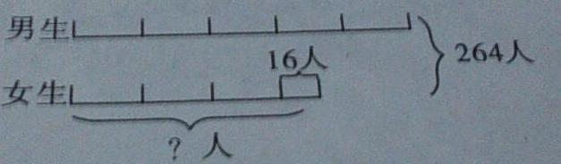

# Mathematics (Grade 6)

**ID**: 4785da81
**难度**: medium
**题型**: fill_in_the_blank

## 题目

 男生
 女生  16人  ？人  264人

## 解答

**答案**: 109

1. Step1:从图中可知男生和女生的总人数是264人，女生比3份多16人，所以先计算去掉16人后男女生的总人数，即264 - 16 = 248人
2. Step2:从图中可知男生是5份，女生去掉16人后是3份，那么总份数是5 + 3 = 8份
3. Step3:用去掉16人后的总人数除以总份数，得到每份的人数，即248÷8 = 31人
4. Step4:计算女生3份的人数，为31×3 = 93人
5. Step5:计算女生的总人数，为女生3份的人数加上多的16人，即93 + 16 = 109人

## 知识点

**知识点**:
  - --

---
