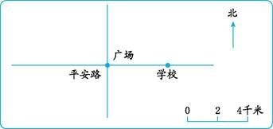

# Mathematics (Grade 6)

**ID**: 47d4c5c3
**难度**: medium
**题型**: fill_in_the_blank

## 题目
下面是某街区的平面图。

(1)把这幅平面图的线段比例尺改写成数值比例尺是（______）。
(2)学校位于广场正东方向约（____）千米处。

## 解答

**答案**: 1∶200000, 4

1. Step1:根据线段比例尺，图上1厘米代表实际距离2千米，因为1千米 = 100000厘米，所以2千米 = 200000厘米，改写成数值比例尺为1∶200000
2. Step2:通过观察平面图，可知学校位于广场正东方向，结合线段比例尺，测量得出学校到广场图上距离约为2厘米，实际距离为2×2 = 4千米

## 知识点

**知识点**:
  - 小学数学;数与代数;比和比例;比例;比例尺的意义

---
