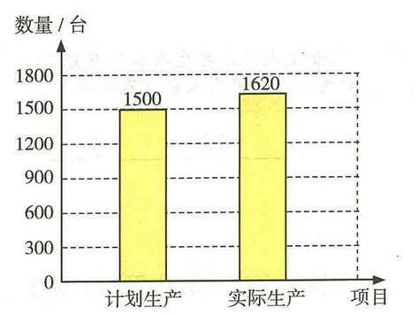

# Mathematics (Grade 6)

**ID**: 47fb8256
**难度**: medium
**题型**: fill_in_the_blank

## 题目
计算机厂今年第三季度计划生产和实际生产计算机台数如下图. 计划生产1500台，实际生产1620台，实际生产的台数比计划增产了百分之几？

## 解答

**答案**: 8%

1. Step1:先计算实际比计划多生产的台数，即1620 - 1500 = 120台
2. Step2:根据增产百分比的计算公式，增产百分比=多生产的台数÷计划生产的台数×100%，这里计划生产台数为1500台，所以增产百分比为120÷1500×100%
3. Step3:计算120÷1500×100%的结果为8%

## 知识点

**知识点**:
  - 四解决问题
--

---
