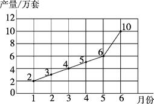

# Mathematics (Grade 6)

**ID**: 490a94ef
**难度**: medium
**题型**: fill_in_the_blank

## 题目
根据折线统计图判断下面的说法是否正确。

(1)4～5月份产量增加得最快。（____）
(2)4月份的产量为5万套。（____）
(3)5月份比3月份多生产2万套。（____）
(4)5～6月份产量增加得最快。（____）

## 解答

**答案**: ×, √, √, √

1. Step1:观察折线统计图，1 - 2月产量从2万套增加到3万套，增加了1万套；2 - 3月从3万套增加到4万套，增加了1万套；3 - 4月从4万套增加到5万套，增加了1万套；4 - 5月从5万套增加到6万套，增加了1万套；5 - 6月从6万套增加到10万套，增加了4万套，所以4～5月份产量不是增加得最快的，(1)错误，答案为×
2. Step2:从统计图中可直接看出4月份对应的产量为5万套，所以(2)正确，答案为√
3. Step3:5月份产量为6万套，3月份产量为4万套，6 - 4 = 2万套，所以5月份比3月份多生产2万套，(3)正确，答案为√
4. Step4:由Step1分析可知，5 - 6月产量增加了4万套，比其他相邻月份增加的数量都多，所以5～6月份产量增加得最快，(4)正确，答案为√

## 知识点

**知识点**:
  - 小学数学;统计和概率;统计;统计图表的综合应用

---
