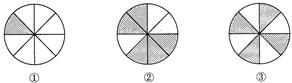

# Mathematics (Grade 6)

**ID**: 50addd07
**难度**: medium
**题型**: fill_in_the_blank

## 题目
转盘游戏。

(1)转动（______）号转盘，指针落在阴影区域的可能性最大。
(2)转动（______）号转盘，指针落在白色区域的可能性最大。
(3)转动（______）号转盘，指针落在两种颜色区域的可能性一样大。

## 解答

**答案**: ②, ①, ③

1. Step1:比较三个转盘中阴影区域面积大小，②号转盘阴影区域面积最大，所以转动②号转盘，指针落在阴影区域的可能性最大
2. Step2:比较三个转盘中白色区域面积大小，①号转盘白色区域面积最大，所以转动①号转盘，指针落在白色区域的可能性最大
3. Step3:观察三个转盘，③号转盘阴影区域和白色区域面积一样大，所以转动③号转盘，指针落在两种颜色区域的可能性一样大

## 知识点

**知识点**:
  - 小学数学;统计和概率;可能性;可能性的大小

---
