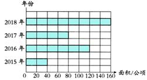

# Mathematics (Grade 6)

**ID**: 6089e7cd
**难度**: medium
**题型**: fill_in_the_blank

## 题目
下面是某地近四年植树造林情况统计图。

(1)这个统计图中，每格代表（_____）公顷。
(2)（_____）年植树造林的面积最大，是（_____）公顷。
(3)2015—2018年植树造林总面积是（_____）公顷。

## 解答

**答案**: 20, 2018, 160, 400

1. Step1:观察统计图的横轴刻度，0到20之间间隔一格，可知每格代表20公顷
2. Step2:对比2015 - 2018年各年对应的条形长度，发现2018年对应的条形最长，其对应的面积是160公顷，所以2018年植树造林的面积最大，是160公顷
3. Step3:2015年对应的面积是40公顷，2016年对应的面积是100公顷，2017年对应的面积是100公顷，2018年对应的面积是160公顷，将这四年的面积相加，40 + 100 + 100 + 160 = 400公顷，所以2015 - 2018年植树造林总面积是400公顷

## 知识点

**知识点**:
  - 小学数学;统计和概率;统计;统计图;简单条形统计图

---
