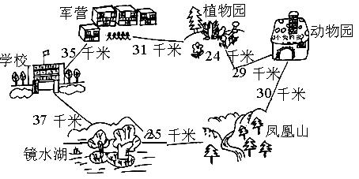

# Mathematics (Grade 6)

**ID**: 660183ae
**难度**: medium
**题型**: fill_in_the_blank

## 题目
看图计算． 

（1）学校→军营→植物园，要行________千米．   
（2）从军营→动物园比从镜水湖→动物园远________千米．

## 解答

**答案**: 66, 29

1. Step1:计算学校→军营→植物园的路程，由图可知学校到军营是35千米，军营到植物园是31千米，两者相加可得35 + 31 = 66千米，这就是第一空的答案
2. Step2:计算从军营→动物园的距离，由图可知军营到植物园是31千米，植物园到动物园是24千米，两者相加得31 + 24 = 55千米；计算从镜水湖→动物园的距离，镜水湖到凤凰山是25千米，凤凰山到动物园是30千米，两者相加得25 + 30 = 55千米；然后求两者的差值55 - 26 = 29千米，这就是第二空的答案

## 知识点

**知识点**:
  - 小学数学;数与代数;应用题;常见的数学问题;图文问题

---
