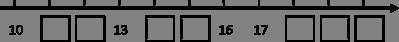

# Mathematics (Grade 6)

**ID**: 714ec36b
**难度**: medium
**题型**: fill_in_the_blank

## 题目

（1）16的前面的一个数是（______），后面的一个数是（______）。
（2）与13相邻的两个数是（______）和（______）。
（3）17和20两个数，（______）更接近18。
（4）比12大，比16小的数有（_______）。

## 解答

**答案**: 15, 17, 12, 14, 17, 13、14、15

1. Step1:根据数的顺序，16前面的一个数是16 - 1 = 15
2. Step2:16后面的一个数是16 + 1 = 17
3. Step3:与13相邻的前面一个数是13 - 1 = 12
4. Step4:与13相邻的后面一个数是13 + 1 = 14
5. Step5:计算17与18的差值为18 - 17 = 1，20与18的差值为20 - 18 = 2，1小于2，所以17更接近18
6. Step6:比12大比16小的数为13、14、15

## 知识点

**知识点**:
  - 小学数学;数与代数;数的认识;整数的认识;探索规律;数字排列的规律

---
