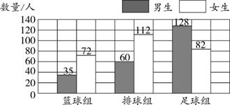

# Mathematics (Grade 6)

**ID**: 71a1437f
**难度**: medium
**题型**: fill_in_the_blank

## 题目
下面是五年级参加课外运动的男、女生人数统计图。

（1）男生人数最多的是（_____）组,最少的是（_____）组。
（2）排球组男生比女生少（____）人,足球组男生比女生多（____）人。
（3）篮球组的人数比排球组少（____）人。

## 解答

**答案**: 足球, 篮球, 52, 46, 65

1. Step1:观察统计图中男生人数，篮球组男生35人，排球组男生60人，足球组男生128人，比较可得128＞60＞35，所以男生人数最多的是足球组，最少的是篮球组。
2. Step2:排球组女生112人，男生60人，用女生人数减去男生人数，即112 - 60 = 52人，所以排球组男生比女生少52人。
3. Step3:足球组男生128人，女生82人，用男生人数减去女生人数，即128 - 82 = 46人，所以足球组男生比女生多46人。
4. Step4:篮球组人数为35 + 72 = 107人，排球组人数为60 + 112 = 172人，用排球组人数减去篮球组人数，即172 - 107 = 65人，所以篮球组的人数比排球组少65人。

## 知识点

**知识点**:
  - 小学数学;统计和概率;统计;统计图表的综合应用

---
