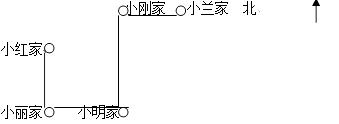

# Mathematics (Grade 6)

**ID**: 72bc9596
**难度**: medium
**题型**: fill_in_the_blank

## 题目
看图，判断。

（1）小刚家在小红家的北边。（_______）
（2）小丽家在小红家的南边。（_______）
（3）小红家去小刚家比小明家去小刚家近。（_______）
（4）小兰家在小刚家东边。（_______）

## 解答

**答案**: ×, √, ×, √

1. Step1:根据图中方向标识，上北下南左西右东，观察小刚家与小红家的位置关系，小刚家在小红家右上方，即东北方向，不是北边，所以（1）答案为×
2. Step2:观察小丽家与小红家的位置关系，小丽家在小红家正下方，即南边，所以（2）答案为√
3. Step3:从图中可以看出，小红家到小刚家的水平距离和垂直距离之和大于小明家到小刚家的水平距离，所以小红家去小刚家比小明家去小刚家远，（3）答案为×
4. Step4:观察小兰家与小刚家的位置关系，小兰家在小刚家右方，即东边，所以（4）答案为√

## 知识点

**知识点**:
  - 

---
