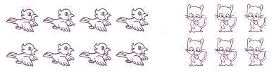

# Mathematics (Grade 6)

**ID**: 768b798e
**难度**: medium
**题型**: fill_in_the_blank

## 题目
谁多？多多少？ 

□○□＝□

## 解答

**答案**: 小鸟, 2

1. Step1:数出小鸟的数量为8只
2. Step2:数出小猫的数量为6只
3. Step3:比较8和6的大小，得出8＞6，所以小鸟数量多
4. Step4:用小鸟的数量8减去小猫的数量6，即8 - 6 = 2，得出小鸟比小猫多2只

## 知识点

**知识点**:
  - 小学数学;数与代数;应用题;常见的数学问题;图文问题

---
