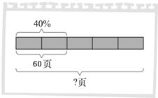

# Mathematics (Grade 6)

**ID**: 7e61e9da
**难度**: medium
**题型**: fill_in_the_blank

## 题目
解决问题：

## 解答

**答案**: 150

1. Step1:根据题目可知总页数的40%是60页，将总页数看作单位'1'。
2. Step2:依据分数除法意义，已知一个数的几分之几是多少，求这个数用除法计算。
3. Step3:所以用60除以40%，即60÷40% = 150页，得出总页数为150页。

## 知识点

**知识点**:
  - 百分数的实际应用．

---
