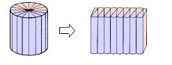

# Mathematics (Grade 6)

**ID**: 7ecb6115
**难度**: medium
**题型**: fill_in_the_blank

## 题目
如图，把底面周长18.84cm，高10cm的圆柱切成若干等份，拼成一个近似的长方体。这个长方体的长是（  ）厘米，宽是（  ）厘米，高是（  ）厘米，底面积是（  ）cm$^{2}$，表面积是（  ）cm$^{2}$，体积是（  ）cm$^{3}$。

## 解答

**答案**: 9.42, 3, 10, 28.26, 304.92, 282.6

1. Step1:根据圆柱底面周长公式$C = 2\pi r$，已知底面周长$C = 18.84$cm，可得半径$r = 18.84\div(2	imes3.14)=3$cm，此为长方体的宽；
2. Step2:长方体的长是圆柱底面周长的一半，即$18.84\div2 = 9.42$cm；
3. Step3:长方体的高等于圆柱的高，为10cm；
4. Step4:长方体底面积等于圆柱底面积，根据圆的面积公式$S=\pi r^{2}$，可得$3.14×3^{2}=28.26$cm²；
5. Step5:计算长方体表面积，长方体表面积 = （长×宽 + 长×高 + 宽×高）×2，即$(9.42×3 + 9.42×10 + 3×10)×2=(28.26 + 94.2 + 30)×2 = 152.46×2 = 304.92$cm²；
6. Step6:长方体体积等于圆柱体积，根据圆柱体积公式$V = S_{底}h$，可得$28.26×10 = 282.6$cm³

## 知识点

**知识点**:
  - 

---
