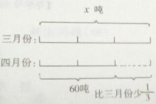

# Mathematics (Grade 6)

**ID**: 843d3980
**难度**: medium
**题型**: fill_in_the_blank

## 题目

 三月份：x吨
 四月份：60吨，比三月份少
 $\frac{1}{3}$

## 解答

**答案**: 90

1. Step1:分析得出四月份产量是三月份产量的$1 - rac{1}{3} = rac{2}{3}$
2. Step2:已知四月份产量为60吨，根据分数除法的意义，用四月份产量除以其占三月份产量的分率，即$60\divrac{2}{3}$
3. Step3:计算$60\divrac{2}{3}=60	imesrac{3}{2}=90$吨，得出三月份产量为90吨

## 知识点

**知识点**:
  - --

---
