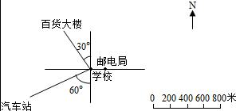

# Mathematics (Grade 6)

**ID**: 857f101f
**难度**: medium
**题型**: fill_in_the_blank

## 题目
下面是小丽以学校为观测点，画出的一张平面图．

①邮电局在学校的(    )方向(    )米处．
②百货大楼在学校(    )偏(    )°方向(    )米处．

## 解答

**答案**: 正东, 200, 北, 西30, 400

1. Step1:观察平面图，确定邮电局相对于学校的方向，可得邮电局在学校的正东方向
2. Step2:量得从学校到邮电局的图上距离为1个线段长，由比例尺可知1个线段长代表实际距离200米，所以邮电局到学校的实际距离为1×200=200米
3. Step3:观察平面图，确定百货大楼相对于学校的方向，可得百货大楼在学校北偏西30°方向
4. Step4:量得从学校到百货大楼的图上距离为2个线段长，由比例尺可知1个线段长代表实际距离200米，所以百货大楼到学校的实际距离为2×200=400米

## 知识点

**知识点**:
  - 根据方向和距离确定物体的位置．

---
