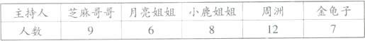

# Mathematics (Grade 6)

**ID**: 93234b26
**难度**: medium
**题型**: fill_in_the_blank

## 题目
下面调查的是二(1)班学生最喜欢的少儿节目主持人的情况。

（1）全班共有________人。   
（2）最喜欢________的人数最多，最喜欢________的人数最少。

## 解答

**答案**: 42, 周洲, 月亮姐姐

1. Step1:要得出全班人数，需将喜欢不同主持人的人数相加，即9 + 6 + 8 + 12 + 7 = 42人，所以全班共有42人
2. Step2:比较喜欢各位主持人的人数9、6、8、12、7的大小，12最大，对应的主持人是周洲，6最小，对应的主持人是月亮姐姐，所以最喜欢周洲的人数最多，最喜欢月亮姐姐的人数最少

## 知识点

**知识点**:
  - 

---
