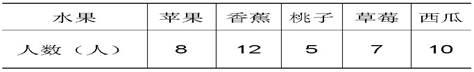

# Mathematics (Grade 6)

**ID**: 9329cea8
**难度**: medium
**题型**: fill_in_the_blank

## 题目
红红调查同学们最喜欢吃的水果，结果如下：

(1)从统计图汇总可以看出，红红调查了（     ）名同学。
(2)最喜欢吃（     ）的人最多，最喜欢吃（    ）的人最少。

## 解答

**答案**: 42, 香蕉, 桃子

1. Step1:计算调查的同学总数，将喜欢苹果、香蕉、桃子、草莓、西瓜的人数相加，即8 + 12 + 5 + 7 + 10 = 42人，所以第一空答案为42
2. Step2:比较喜欢各种水果的人数大小，8、12、5、7、10中12最大，对应的水果是香蕉，所以最喜欢吃香蕉的人最多
3. Step3:比较喜欢各种水果的人数大小，8、12、5、7、10中5最小，对应的水果是桃子，所以最喜欢吃桃子的人最少

## 知识点

**知识点**:
  - 

---
