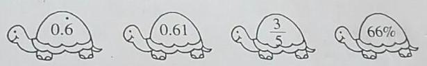

# Mathematics (Grade 6)

**ID**: 9a2440b0
**难度**: medium
**题型**: fill_in_the_blank

## 题目
给下面的小乌龟排排队

 （    ）<（    ）<（    ）<（    ）

## 解答

**答案**: 0.6, 0.61, 0.66, _0.6^

1. Step1:将分数\(rac{3}{5}\)化为小数，\(rac{3}{5}=3\div5 = 0.6\)
2. Step2:将百分数66%化为小数，66% = 66÷100 = 0.66
3. Step3:比较0.6、0.61、0.66和\(0.\dot{6}\)的大小，先比较十分位，都是6，再比较百分位，0.6百分位是0，0.61百分位是1，0.66百分位是6，\(0.\dot{6}\)是无限循环小数，其值大于0.6，小于0.61，所以0.6＜0.61＜0.66＜\(0.\dot{6}\)
4. Step4:按照从小到大的顺序排列为0.6、0.61、0.66、\(0.\dot{6}\)

## 知识点

**知识点**:
  - 

---
