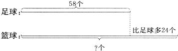

# Mathematics (Grade 6)

**ID**: 9a893e5b
**难度**: medium
**题型**: fill_in_the_blank

## 题目
看图列式计算

□○□=□(个)

## 解答

**答案**: 58, +, 24, 82

1. Step1:明确题目是根据线段图进行列式计算
2. Step2:从图中获取信息，足球有58个
3. Step3:从图中获取信息，篮球比足球多24个
4. Step4:因为求篮球个数，已知一个数比另一个数多多少，求这个数用加法，所以是足球个数加多出的个数，即58 + 24
5. Step5:计算58 + 24的结果为82

## 知识点

**知识点**:
  - 图文应用题;整数的加法和减法．

---
