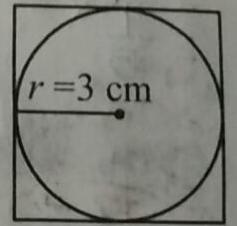

# Mathematics (Grade 6)

**ID**: a1488d20
**难度**: medium
**题型**: fill_in_the_blank

## 题目
如图，正方形的周长是（    ）厘米；圆的周长是（    ）厘米.

## 解答

**答案**: 24, 18.84

1. Step1:根据圆的半径r = 3厘米，可得圆的直径为3×2 = 6厘米
2. Step2:因为圆的直径是正方形的边长，所以正方形边长为6厘米
3. Step3:根据正方形周长公式，正方形周长为6×4 = 24厘米
4. Step4:根据圆的周长公式，圆的周长为3×2×3.14 = 18.84厘米

## 知识点

**知识点**:
  - --

---
