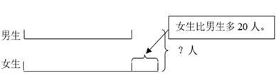

# Mathematics (Grade 6)

**ID**: a2c21e80
**难度**: medium
**题型**: fill_in_the_blank

## 题目
光明小学二年级有男生80人，女生比男生多20人。光明小学二年级一共有学生多少人？

口答：光明小学二年级一共有学生（   ）人。

## 解答

**答案**: 180

1. Step1:已知男生有80人，女生比男生多20人，可先求出女生人数，即女生人数为80 + 20 = 100人
2. Step2:要求二年级一共的学生人数，就是男生人数加女生人数，即80 + 100 = 180人

## 知识点

**知识点**:
  - 小学数学;数与代数;数的运算;整数的四则运算

---
