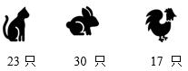

# Mathematics (Grade 6)

**ID**: a75e53a3
**难度**: medium
**题型**: fill_in_the_blank

## 题目

（1）小猫比小兔少（______）只。
（2）小鸡比小猫少（______）只。
（3）小兔比小鸡多（______）只。
（4）猫、兔、鸡一共有（______）只。

## 解答

**答案**: 7, 6, 13, 70

1. Step1:求小猫比小兔少的只数，用小兔的数量30只减去小猫的数量23只，即30 - 23 = 7只
2. Step2:求小鸡比小猫少的只数，用小猫的数量23只减去小鸡的数量17只，即23 - 17 = 6只
3. Step3:求小兔比小鸡多的只数，用小兔的数量30只减去小鸡的数量17只，即30 - 17 = 13只
4. Step4:求猫、兔、鸡一共的只数，将小猫23只、小兔30只、小鸡17只相加，即23 + 30 + 17 = 70只

## 知识点

**知识点**:
  - 小学数学;数与代数;应用题;简单应用题;整数简单应用题

---
