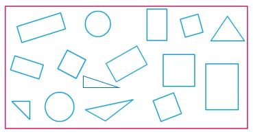

# Mathematics (Grade 6)

**ID**: acaba625
**难度**: medium
**题型**: fill_in_the_blank

## 题目
数一数，填一填。

长方形有（_____）个，正方形有（_____）个，三角形有（_____）个，圆有（_____）个。

## 解答

**答案**: 5, 4, 4, 2

1. Step1:仔细观察图形，从左到右、从上到下依次开始计数长方形的数量，得到长方形有5个
2. Step2:同样按顺序计数正方形的数量，得出正方形有4个
3. Step3:接着按顺序数三角形的数量，可知三角形有4个
4. Step4:最后按顺序数圆的数量，得到圆有2个

## 知识点

**知识点**:
  - 小学数学;图形与几何;平面图形;平面图形的认识及分类

---
