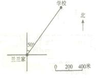

# Mathematics (Grade 6)

**ID**: b2b099eb
**难度**: medium
**题型**: fill_in_the_blank

## 题目
看图回答问题。 

学校在兰兰家________偏________  ________ º方向的________米处。

## 解答

**答案**: 北, 东, 50, 800

1. Step1:观察图中学校相对于兰兰家的方向，可知是北偏东方向
2. Step2:从图中获取角度信息，确定角度为50°
3. Step3:根据图中的比例尺，一格代表200米，学校与兰兰家间隔4格，计算距离为200×4 = 800米
4. Step4:整理信息，得到学校在兰兰家北偏东50°方向的800米处，对应答案为['北', '东', '50', '800']

## 知识点

**知识点**:
  - 

---
