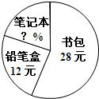

# Mathematics (Grade 6)

**ID**: b4b0ca58
**难度**: medium
**题型**: fill_in_the_blank

## 题目
小明用50元钱购买了三种学习用品（如图），他购买笔记本的钱占总钱数的$\underline{\hspace{5em}}$%．

## 解答

**答案**: 20

1. Step1:计算购买铅笔盒和书包总共花费的钱数，12 + 28 = 40（元）
2. Step2:计算购买笔记本花费的钱数，50 - 40 = 10（元）
3. Step3:计算购买笔记本的钱占总钱数的百分比，10÷50×100% = 20%

## 知识点

**知识点**:
  - 扇形统计图；百分数的实际应用．

---
