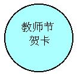

# Mathematics (Grade 6)

**ID**: b7f063ff
**难度**: medium
**题型**: fill_in_the_blank

## 题目
小红用彩色纸板为老师制作了一张圆形贺卡，为了美观，她特地买来彩绳粘到了贺卡的外围，制作这张贺卡共用了31.4厘米的彩绳．你知道她用了________平方厘米的彩色纸板吗？

## 解答

**答案**: 78.5

1. Step1:根据已知条件，31.4厘米是圆形贺卡的周长，由圆的周长公式C = 2πr（C为周长，r为半径，π取3.14），可得半径r = C÷(2π) = 31.4÷(2×3.14) = 5厘米。
2. Step2:再根据圆的面积公式S = πr²（S为面积，r为半径，π取3.14），将半径r = 5厘米代入，可得面积S = 3.14×5² = 78.5平方厘米。

## 知识点

**知识点**:
  - 小学数学;图形与几何;平面图形;圆;圆的周长;圆的面积

---
