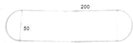

# Mathematics (Grade 6)

**ID**: bccc3762
**难度**: medium
**题型**: fill_in_the_blank

## 题目
求图中图形的周长（单位：分米）

## 解答

**答案**: 557

1. Step1:明确图形由两个半圆和一个长方形组成，两个半圆可拼成一个整圆，其直径为50分米，长方形的长为200分米
2. Step2:根据圆的周长公式C = πd（其中d为直径，π取3.14），计算圆的周长为3.14×50
3. Step3:长方形两条长边的长度为200×2
4. Step4:将圆的周长与长方形两条长边的长度相加，即3.14×50 + 200×2
5. Step5:计算3.14×50 + 200×2的结果，先算乘法得157 + 400，再算加法得557，此即为图形的周长

## 知识点

**知识点**:
  - 圆、圆环的周长

---
