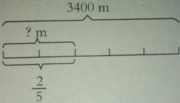

# Mathematics (Grade 6)

**ID**: c17b3abd
**难度**: medium
**题型**: fill_in_the_blank

## 题目
3400m的
   $\frac{2}{5}$
   是多少m？

## 解答

**答案**: 1360

1. Step1:明确题目是求3400m的$rac{2}{5}$，根据分数乘法的意义，用乘法计算
2. Step2:列出算式3400×$rac{2}{5}$
3. Step3:计算3400÷5 = 680
4. Step4:计算680×2 = 1360，得出结果为1360m

## 知识点

**知识点**:
  - --

---
