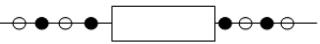

# Mathematics (Grade 6)

**ID**: c3873d76
**难度**: medium
**题型**: fill_in_the_blank

## 题目
串了一些黑白间隔排列的珠子，中间有一部分被挡住了。被挡住的部分（_______）色的珠子多；如果这串珠子中白珠子有18颗，黑珠子有（_______）颗。

## 解答

**答案**: 白, 17

1. Step1:观察珠子排列规律，发现是黑白间隔排列，且两端都是白珠子，所以白珠子比黑珠子多1颗
2. Step2:因为白珠子有18颗，根据白珠子比黑珠子多1颗，可得出黑珠子数量为18 - 1 = 17颗
3. Step3:因为白珠子比黑珠子多，所以被挡住的部分白色的珠子多
4. Step4:综上，第一个空填白，第二个空填17

## 知识点

**知识点**:
  - 小学数学;探索规律;简单间隔、周期规律

---
