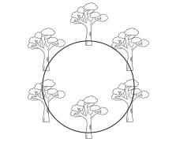

# Mathematics (Grade 6)

**ID**: cac9f4b9
**难度**: medium
**题型**: fill_in_the_blank

## 题目
考考你：有一个圆形花坛，花坛的一周种了6棵树，每两棵树之间是1米，这个圆形花坛一周大约是（）米。

## 解答

**答案**: 6

1. Step1:明确这是封闭路线植树问题，已知圆形花坛一周种树的株数为6棵，每两棵树之间的株距是1米
2. Step2:根据封闭线路上全长=株距×株数的数量关系，确定列式为6×1
3. Step3:计算6×1的结果为6，得出圆形花坛一周大约是6米

## 知识点

**知识点**:
  - 植树问题之封闭型(奥数)

---
