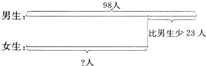

# Mathematics (Grade 6)

**ID**: cfb1fde4
**难度**: medium
**题型**: fill_in_the_blank

## 题目
看图列式计算

□○□=□(人)

## 解答

**答案**: 98, -, 23, =, 75, (人)

1. Step1:明确题目是根据线段图进行列式计算
2. Step2:从图中获取男生人数为98人
3. Step3:从图中获取女生比男生少23人这一信息
4. Step4:因为求比一个数少几的数用减法，所以确定用男生人数减去少的人数来计算女生人数
5. Step5:得出算式为98 - 23
6. Step6:计算98 - 23的结果为75
7. Step7:完整的列式表达为98 - 23 = 75(人)

## 知识点

**知识点**:
  - 图文应用题;整数的加法和减法．

---
