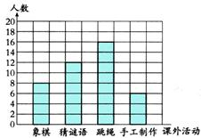

# Mathematics (Grade 6)

**ID**: d6201882
**难度**: medium
**题型**: fill_in_the_blank

## 题目
龙川居委会配合龙川小学组织学生开展课外活动。下面是四年级同学参加的课外活动情况统计图。

(1)参加（_____）活动的人数最多，有（_____）人；参加（_____）活动的人数最少，有（_____）人。
(2)参加猜谜语活动的人数是参加手工制作活动的人数是（____）倍。

## 解答

**答案**: 跳绳, 16, 手工制作, 6, 2

1. Step1:观察统计图，获取参加各项活动的人数，其中参加跳绳活动的人数是16人，参加猜谜语活动的人数是12人，参加手工制作活动的人数是6人，参加课外活动的人数是8人。
2. Step2:比较各项活动人数的多少，16＞12＞8＞6，所以参加跳绳活动的人数最多，有16人；参加手工制作活动的人数最少，有6人。
3. Step3:计算参加猜谜语活动的人数是参加手工制作活动人数的几倍，用参加猜谜语活动的人数除以参加手工制作活动的人数，即12÷6 = 2，所以参加猜谜语活动的人数是参加手工制作活动的人数的2倍。

## 知识点

**知识点**:
  - 小学数学;统计和概率;统计;统计图;简单条形统计图

---
