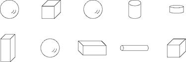

# Mathematics (Grade 6)

**ID**: de208e77
**难度**: medium
**题型**: fill_in_the_blank

## 题目
我会填

1.上图共有（____）个图形，2个2个地数，要数（____）次；5个5个地数，要数（____）次。
2.球有（____）个，正方体有（____）个，长方体有（____）个，圆柱有（____）个。长方体比球少（____）个，圆柱比正方体多（____）个。

## 解答

**答案**: 10, 5, 2, 3, 2, 2, 3, 1, 1

1. Step1:数出图中图形的总数为10个
2. Step2:因为总数是10个，2个2个地数，10÷2 = 5，所以要数5次
3. Step3:因为总数是10个，5个5个地数，10÷5 = 2，所以要数2次
4. Step4:数出球的个数为3个
5. Step5:数出正方体的个数为2个
6. Step6:数出长方体的个数为2个
7. Step7:数出圆柱的个数为3个
8. Step8:长方体有2个，球有3个，3 - 2 = 1，所以长方体比球少1个
9. Step9:圆柱有3个，正方体有2个，3 - 2 = 1，所以圆柱比正方体多1个

## 知识点

**知识点**:
  - 

---
