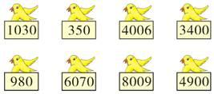

# Mathematics (Grade 6)

**ID**: e2527885
**难度**: medium
**题型**: fill_in_the_blank

## 题目
帮这些数分分类。

（1）最大的数是（_____），最小的数是（_____）。
（2）接近5000的数是（_____）。
（3）只读一个零的数有（_____），一个0都不读的数有（_____）。

## 解答

**答案**: 9001030, 4006, 4900, 6070, 8009350, 3400, 980

1. Step1:将所给的数1030、350、4006、3400、980、6070、8009、4900进行大小比较，找出最大的数为8009，最小的数为350
2. Step2:判断哪个数接近5000，在这些数中4900与5000差值相对较小，所以接近5000的数是4900
3. Step3:根据整数的读法，判断只读一个零的数，1030读作一千零三十，4006读作四千零六，6070读作六千零七十，8009读作八千零九，所以只读一个零的数有1030、4006、6070、8009
4. Step4:根据整数的读法，判断一个0都不读的数，350读作三百五十，3400读作三千四百，980读作九百八十，4900读作四千九百，所以一个0都不读的数有350、3400、980、4900

## 知识点

**知识点**:
  - 小学数学;数与代数;数的认识;整数的认识

---
