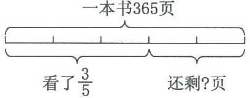

# Mathematics (Grade 6)

**ID**: e8168aa2
**难度**: medium
**题型**: fill_in_the_blank

## 题目

 一本书365页 看了
 $\frac{3}{5}$
  还剩？页

## 解答

**答案**: 146

1. Step1:计算没看的部分占总页数的比例，1 - 3/5 = 2/5
2. Step2:用总页数乘以没看部分占比求出剩余页数，365 * 2/5 = 146

## 知识点

**知识点**:
  - 第五单元 分数四则混合运算;第2课时 分数四则混合运算应用题（一）

---
