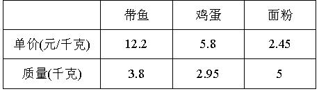

# Mathematics (Grade 6)

**ID**: eb796e0c
**难度**: medium
**题型**: fill_in_the_blank

## 题目
星期日，妈妈到超市购物，购物记录如下：

请你估计一下，妈妈带80元钱够吗？________

## 解答

**答案**: 够

1. Step1:将带鱼单价12.2元/千克估算为12元/千克，质量3.8千克估算为4千克
2. Step2:将鸡蛋单价5.8元/千克估算为6元/千克，质量2.95千克估算为3千克
3. Step3:将面粉单价2.45元/千克估算为2.5元/千克，质量5千克不变
4. Step4:根据总价=数量×单价，计算估算后的总价，即12×4+6×3+2.5×5
5. Step5:计算12×4+6×3+2.5×5=48+18+12.5=78.5元
6. Step6:比较78.5元与80元的大小，78.5元<80元，得出妈妈带80元钱够

## 知识点

**知识点**:
  - 小学数学;数与代数;数的运算;小数的四则运算;应用题;常见的数学问题;经济问题

---
