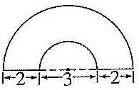

# Mathematics (Grade 6)

**ID**: edcc86a8
**难度**: medium
**题型**: fill_in_the_blank

## 题目
如图,小圆直径为3cm，圆环宽2cm，小圆的半径是（  ），大圆的半径是（  ），大圆的直径是（  ）.

## 解答

**答案**: 1.5, 3.5, 7

1. Step1:根据圆的半径等于直径的一半，已知小圆直径为3cm，所以小圆半径为3÷2=1.5cm
2. Step2:由图可知，大圆直径是小圆直径加上两个圆环的宽度，即2+3+2=7cm
3. Step3:因为圆的半径等于直径的一半，大圆直径为7cm，所以大圆半径为7÷2=3.5cm

## 知识点

**知识点**:
  - 圆-圆的认识-认识圆（1）

---
