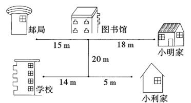

# Mathematics (Grade 6)

**ID**: f7d51aae
**难度**: medium
**题型**: fill_in_the_blank

## 题目
看图填一填。

（1）小明家到学校有（______）m,小利家到学校有（______）m,（______）家离学校近。
（2）小明的爸爸让他去邮局寄信,小明从家要走（______）m才能到邮局。
（3）放学后,小利要去图书馆借书,她要走（______）m才能到图书馆。

## 解答

**答案**: 52, 19, 小利, 33, 34

1. Step1:计算小明家到学校的距离，小明家到图书馆是18m，图书馆到邮局是15m，邮局到学校的垂直距离是20m，水平距离是14m，所以小明家到学校的距离为18 + 15 + 20 + 14 = 52m
2. Step2:计算小利家到学校的距离，小利家到图书馆的水平距离是5m，垂直距离是14m，图书馆到学校的垂直距离是20m，所以小利家到学校的距离为5 + 14 = 19m
3. Step3:比较小明家和小利家到学校的距离，52＞19，所以小利家离学校近
4. Step4:计算小明从家到邮局的距离，小明家到图书馆是18m，图书馆到邮局是15m，所以小明从家到邮局要走18 + 15 = 33m
5. Step5:计算小利去图书馆要走的距离，小利家到图书馆的水平距离是5m，垂直距离是20m，所以小利要走5 + 20 = 34m

## 知识点

**知识点**:
  - 小学数学;数与代数;数的运算;整数的四则运算;进位加法

---
