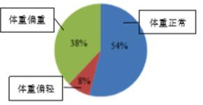

# Mathematics (Grade 6)

**ID**: ff9dbf06
**难度**: medium
**题型**: fill_in_the_blank

## 题目
如图是某公司职工体重调查结果的统计图，已知体重正常的职工有 189 人．那么该公司有职工_______人，体重偏重的职工有_______人，体重偏轻的职工有_______人．

## 解答

**答案**: 350, 133, 28

1. Step1:由统计图可知体重正常的职工占比54%，已知体重正常的职工有189人，根据公式总人数 = 体重正常人数÷体重正常人数占比，可得该公司职工总人数为189÷54% = 350人
2. Step2:由统计图可知体重偏重的职工占比38%，根据公式体重偏重人数 = 总人数×体重偏重人数占比，可得体重偏重的职工人数为350×38% = 133人
3. Step3:由统计图可知体重偏轻的职工占比8%，根据公式体重偏轻人数 = 总人数×体重偏轻人数占比，可得体重偏轻的职工人数为350×8% = 28人

## 知识点

**知识点**:
  - 小学数学;统计和概率;统计;统计图;扇形统计图的特点及绘制;统计图表的综合应用

---
