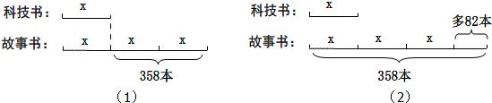

# Mathematics (Grade 6)

**ID**: 0427931e
**难度**: medium_hard
**题型**: fill_in_the_blank

## 题目
看图只列方程不解答．

(1)方程：______；  
(2)方程：______．

## 解答

**答案**: 3x-x=358, 3x+82=358

1. Step1:观察图(1)，设科技书有x本，由图可知故事书是科技书的3倍，即故事书有3x本，根据故事书本数 - 科技书本数 = 358本，列出方程3x - x = 358
2. Step2:观察图(2)，设科技书有x本，由图可知故事书比科技书的3倍还多82本，即故事书有3x + 82本，又已知故事书为358本，根据故事书的数量关系列出方程3x + 82 = 358

## 知识点

**知识点**:
  - 列方程解应用题(两步需要逆思考)．

---
