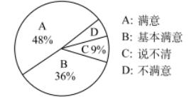

# Mathematics (Grade 6)

**ID**: 047a0cf9
**难度**: medium_hard
**题型**: fill_in_the_blank

## 题目
某商场为了了解本商场的服务质量，随机调查了来本商场的200名顾客，调查的结果如图所示。根据图中给出的信息，这200名顾客中对该商场的服务质量表示不满意的有 $\underline{\hspace{5em}}$ 人。

## 解答

**答案**: 14

1. Step1:先计算满意、基本满意和说不清的人数占比之和，即48%+36%+9%=93%
2. Step2:用1减去上述占比之和，得到不满意人数占总人数的百分比，即1 - 93% = 7%
3. Step3:用总人数200乘以不满意人数占比7%，即200×7% = 14人

## 知识点

**知识点**:
  - 扇形统计图的认识及绘制;从统计图表中获取信息

---
