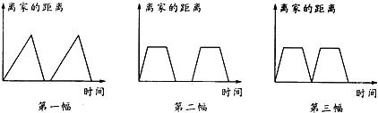

# Mathematics (Grade 6)

**ID**: 09b694b5
**难度**: medium_hard
**题型**: fill_in_the_blank

## 题目
我们每天早晨上学，中午放学吃完午饭后，休息一段时间，下午再上学，傍晚时放学．下面哪幅图比较准确地反映了我们一天的行为？$\underline{\hspace{5em}}$．

## 解答

**答案**: 第二幅图

1. Step1:明确我们一天的行为是早晨上学，中午放学、吃午饭、休息，下午上学，傍晚放学
2. Step2:思考折线统计图中各阶段对应的距离变化，上学时离家距离增加，放学时离家距离减少，午休时离家距离为 0 保持不变
3. Step3:对比三幅图，第一幅图没有体现出午休时离家距离为 0 保持不变的状态；第三幅图不符合上学和放学的距离变化顺序；第二幅图符合上学时离家距离增加，午休时离家距离为 0 保持不变，放学时离家距离减少的情况
4. Step4:得出结论，第二幅图比较准确地反映了我们一天的行为

## 知识点

**知识点**:
  - 简单的行程问题；单式折线统计图．

---
