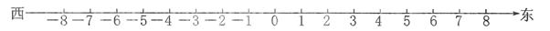

# Mathematics (Grade 6)

**ID**: 0b054b4b
**难度**: medium_hard
**题型**: fill_in_the_blank

## 题目
下面直线上的1小格表示1m，小君开始的位置在“0”处。

（1）如果小君从“0”处向东走6m表示为＋6m，那么他从“0”处向西走8m，可表示为（_____）m。
（2）如果小君的位置是＋10m，那么说明他是向（_____）走了（_____）m。
（3）如果小君先向东走7m，再向西走12m，那么这时小君的位置是（_____）m。

## 解答

**答案**: -8, 东, 10, -5

1. Step1:根据正负数表示相反意义的量，向东走为正，那么向西走就为负，所以从“0”处向西走8m，表示为 -8m
2. Step2:因为向东走用正数表示，位置是＋10m，所以说明是向东走了10m
3. Step3:小君先向东走7m，位置是 +7m，再向西走12m，相当于在 +7m 的基础上减去12m，7 - 12 = -5m，所以这时小君的位置是 -5m

## 知识点

**知识点**:
  - 小学数学;数与代数;数的认识

---
