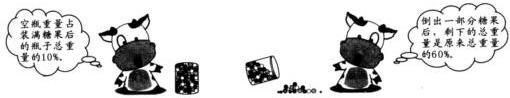

# Mathematics (Grade 6)

**ID**: 0bb960c1
**难度**: medium_hard
**题型**: fill_in_the_blank

## 题目
如果空瓶重量占装满糖果后的瓶子总重量的10%，倒出一部分糖果后，剩下的总重量是原来总重量的60%，那么，剩下的糖果是原来糖果的重量的$\underline{\hspace{5em}}$．

## 解答

**答案**: 5/9

1. Step1:设瓶子和糖果总重量为1
2. Step2:计算空瓶重量，1×10%=0.1
3. Step3:计算糖果重量，1 - 0.1=0.9
4. Step4:计算剩下糖果的重量，1×60% - 0.1=0.5
5. Step5:计算剩下的糖果是原来糖果重量的比例，0.5÷0.9=5/9

## 知识点

**知识点**:
  - 分数和百分数应用题（多重条件）．

---
