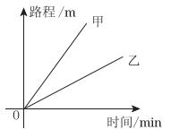

# Mathematics (Grade 6)

**ID**: 0c9da390
**难度**: medium_hard
**题型**: fill_in_the_blank

## 题目
如图是甲、乙两名运动员在自行车比赛中所走路程与时间的关系图象，则甲的速度 $\underline{\hspace{5em}}$ 乙的速度（用或“＞”“=”或“＜”填空）.

## 解答

**答案**: ＞

1. Step1:明确路程、速度和时间的关系为s = vt
2. Step2:知道在同一时刻，s越大，v越大，在图象上表现为越陡峭
3. Step3:观察图象，发现同一时刻甲的路程大于乙的路程
4. Step4:根据同一时刻路程与速度的关系，得出甲的速度大于乙的速度，所以应填＞

## 知识点

**知识点**:
  - 正比例函数的图象和性质

---
