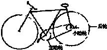

# Mathematics (Grade 6)

**ID**: 114a7b4d
**难度**: medium_hard
**题型**: fill_in_the_blank

## 题目
如图是一辆自行车，主动轮有54齿，小动轮有27齿，后轮直径为1米，如果每秒蹬2圈(即主动轮转2圈)，则这辆自行车一小时能行______千米．

## 解答

**答案**: 45.216

1. Step1:根据圆的周长公式C = πd，其中d = 1米，π取3.14，计算后轮的周长，即3.14×1 = 3.14米
2. Step2:计算主动轮齿数与小动轮齿数的比值，54÷27 = 2
3. Step3:计算自行车1秒钟行驶的路程，根据公式自行车所行路程=(主动轮÷小动轮)×后轮周长×每秒主动轮转的圈数，可得2×3.14×2 = 12.56米
4. Step4:因为1小时 = 3600秒，计算自行车1小时行驶的路程，即12.56×3600 = 45216米
5. Step5:将45216米换算成千米，因为1千米 = 1000米，所以45216÷1000 = 45.216千米

## 知识点

**知识点**:
  - 有关圆的应用题．

---
