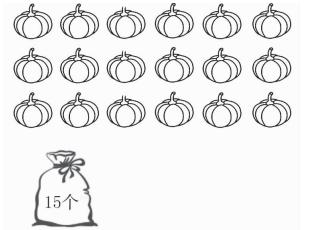

# Mathematics (Grade 6)

**ID**: 17209cdf
**难度**: medium_hard
**题型**: fill_in_the_blank

## 题目
下面散放的南瓜和袋子里的南瓜相比，哪个多？哪个少？散放的比袋子里的（）。（填“多得多”“多一些”“少得多”或“少一些”）

## 解答

**答案**: 多一些

1. Step1:数出散放南瓜的个数为18个
2. Step2:明确袋子里南瓜个数为15个
3. Step3:比较18和15的大小，得出18＞15
4. Step4:判断18和15比较接近，得出散放的比袋子里的多一些

## 知识点

**知识点**:
  - 整数大小的比较

---
