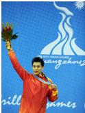

# Mathematics (Grade 6)

**ID**: 175d92b7
**难度**: medium_hard
**题型**: fill_in_the_blank

## 题目
在2008年第29届北京奥运会上，中国队取得了51枚金牌，比2004年雅典奥运会获得金牌数的2倍少13枚．雅典奥运会上中国取得了多少枚金牌吗？

## 解答

**答案**: 32

1. Step1:明确已知条件，2008年北京奥运会中国队取得51枚金牌，且比2004年雅典奥运会获得金牌数的2倍少13枚。
2. Step2:因为51枚比雅典奥运会金牌数的2倍少13枚，所以51 + 13得到的64枚正好是雅典奥运会金牌数的2倍。
3. Step3:根据除法的意义，用64除以2，即64÷2 = 32，得到2004年雅典奥运会中国队获得的金牌数为32枚。

## 知识点

**知识点**:
  - 整数的除法及应用．

---
