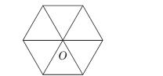

# Mathematics (Grade 6)

**ID**: 1839ae3e
**难度**: medium_hard
**题型**: fill_in_the_blank

## 题目
如图，正六边形至少要绕点O旋转（）度才能与原来的图形重合。

## 解答

**答案**: 60

1. Step1:明确圆周角的度数为360°
2. Step2:由于正六边形的3条对角线将圆周角平均分成6份
3. Step3:根据上述信息，计算正六边形的中心角，即360°÷6 = 60°
4. Step4:得出正六边形绕其对称中心O至少旋转60°后能与原来的正六边形重合，所以答案为60

## 知识点

**知识点**:
  - 图形的旋转

---
