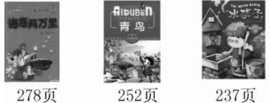

# Mathematics (Grade 6)

**ID**: 1f084dd5
**难度**: medium_hard
**题型**: fill_in_the_blank

## 题目
新华书店到一批图书如下。

（1）《海底两万里》比《青鸟》多多少页？
（2）《水孩子》比《青鸟》少多少页？

## 解答

**答案**: 26, 15

1. Step1:明确问题（1）是求《海底两万里》比《青鸟》多的页数，根据解题方法提示，用《海底两万里》的278页减去《青鸟》的252页，即278 - 252
2. Step2:计算278 - 252的结果为26页，得到问题（1）的答案
3. Step3:明确问题（2）是求《水孩子》比《青鸟》少的页数，根据解题方法提示，用《青鸟》的252页减去《水孩子》的237页，即252 - 237
4. Step4:计算252 - 237的结果为15页，得到问题（2）的答案
5. Step5:将问题（1）和（2）的答案整理成列表['26', '15']

## 知识点

**知识点**:
  - 整数的加法和减法

---
